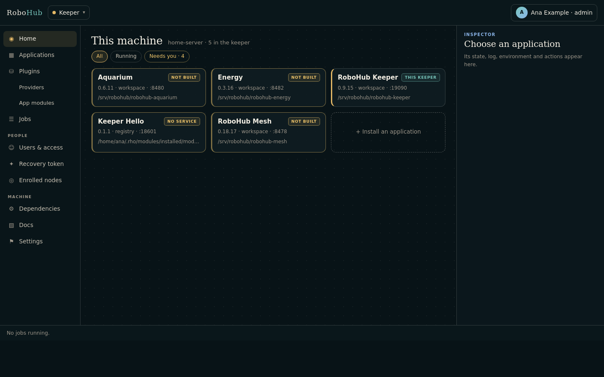
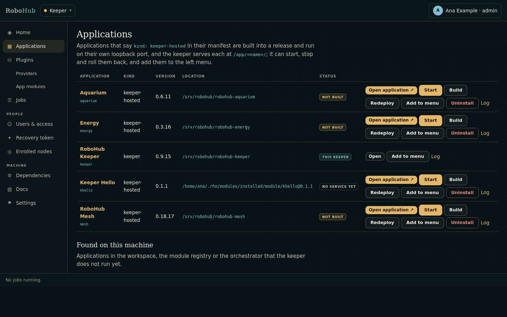
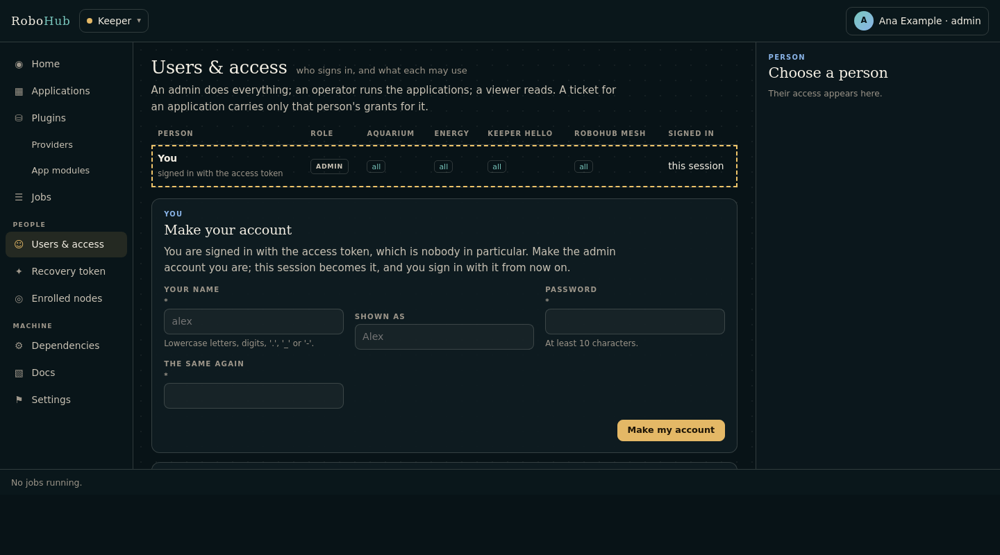

# The RoboHub keeper

The keeper is RoboHub's supervisor and front door. It signs people in for every
application, installs the applications and runs each as a systemd user unit from a
release it made, serves them under its own origin at `/app/<name>/`, and shows what
the machine needs to run them. It is the one page a person opens; Mesh, the
aquarium and energy are reached through it.







## Reaching it

| | |
| --- | --- |
| Address | `http://127.0.0.1:19090/` |
| Unit | `robohub-keeper` (systemd user unit) |
| State | `~/.rho/keeper` (owner-only) |
| Its own settings | `~/.rho/keeper/data/settings.conf` |

The keeper listens on loopback only. It signs people in over plain HTTP, so
reaching it from another machine belongs behind a TLS proxy;
`KEEPER_LISTEN=0.0.0.0 ./scripts/deploy-keeper.sh` opens it to every interface
anyway. `robohub keeper` reaches it from the orchestrator's command line too.

Installing it the first time is described in {ref}`start/install`.

### Building and deploying

```sh
rho build .                      # build into build/keeper
./scripts/deploy-keeper.sh       # build, make a release, restart the unit on it
./scripts/deploy-keeper.sh --status
```

The service runs the release in use (`~/.rho/keeper/apps/keeper/current`), never the
checkout's build, so a rebuild here changes nothing until the next deploy.
`ROBOHUB_ROOT` says where the orchestrator (`robohub`) is when it is not beside this
checkout. Started by hand for a test:

```sh
ROBOHUB_ROOT=../robohub ./build/keeper
```

## Applications behind one origin

Every hosted application is reached through the keeper at
`http://127.0.0.1:19090/app/<name>/` — Mesh at `/app/mesh/mesh`, the aquarium at
`/app/aquarium/`, energy at `/app/energy/`. The keeper's links, **Open application**
and the app switcher in every application's top bar go there.

A browser scopes cookies by host and not by port, so an application on a port of
its own would receive every other application's cookies, the keeper's admin session
among them. Through the keeper it never does:

- The `app_proxy` middleware (in `project.yml`) serves `/app/<name>/…` from the
  application's loopback port and never forwards the keeper's `keeper_session`
  cookie.
- The application's own cookies are scoped to its path, and its root-relative links,
  redirects and form targets are rewritten onto the prefix. `X-Forwarded-Prefix`,
  `-Host` and `-Proto` tell it where it is reached. Server-sent events stream
  through.
- The list of applications and ports is `~/.rho/keeper/proxy.txt` (`name port` per
  line), which the keeper writes whenever its list of applications changes and the
  proxy reads again when the file changes, so a newly installed application is
  reachable without a restart.
- An application signs in through the keeper's origin as well: its callback is
  `/app/<name>/auth/callback` on the keeper's port.

Each application still listens on its own loopback port, which is what the proxy
calls and what a script on the machine may use:

| Application | Name | Loopback port | First page |
| --- | --- | --- | --- |
| Keeper | `keeper` | 19090 | `/` |
| Mesh | `mesh` | 8478 | `/mesh` |
| Aquarium | `aquarium` | 8480 | `/` |
| Energy | `energy` | 8482 | `/` |

An application whose manifest port is already taken is given the next free one from
8500. To go back to linking each application on its own port, set
`keeper.proxy_apps=off` in the keeper's settings file.

## Pages

| Page | What it is for |
| --- | --- |
| **Home** `/` | Every application as a card with its state, and an inspector beside them: folder, port, unit, release in use, journal, environment, and start, stop, restart, build, redeploy and roll back. |
| **Applications** `/applications` | The installed applications, **Install**, the integrations that can run here and the orchestrator's registry. |
| An application `/apps/<name>` | Its state, where it runs, what it needs (**Dependencies**), its journal, its environment and its actions; **Open application** leads into it. |
| **Plugins** `/plugins` | The plugin registry and the alert channels the keeper binds; **Providers** and **App modules** under it. |
| **Jobs** `/jobs` | Builds, redeploys and starts that need a build, each with its log (`/jobs/<id>`). |
| **Users & access** `/people` | People, their roles, their grants per application, and their sessions. |
| **Recovery token** `/auth/token` | Replace the admin's access token; rotate the signing key. |
| **Nodes** `/nodes` | The node identities the keeper has issued. |
| **System** `/system` | What the whole machine needs: every application's and every enabled toolchain module's system dependencies. |
| **Docs** `/docs` | This documentation, built from the documentation site's tree. |
| **Settings** `/settings` | General, Alerts, Auth, Logging, Configuration. |
| **Account** `/account` | Change one's own password. |

An application can be added to the left menu from its row; it then appears under
**Applications** and leads to its page in the keeper. The selection is kept in
`~/.rho/keeper/menu.txt`.

## Installing an application

What the keeper runs is its catalogue, `~/.rho/keeper/installed.yml`: one record per
application with where it came from (`registry`, `workspace`, `bundled`, `external`,
`fetched` or `integration`), where it is, its version, its port and its unit. Pages
and the API read the catalogue rather than scanning folders. On its first start the
keeper adopts what it finds on the machine; after that an application is added
through **Install**:

- **From the Rho registry**, by name — `aquarium` or `aquarium@0.5.0` — with
  `rho module install`. When the registry has a newer version its card says
  **update** and its inspector offers **Update to …**, which installs it, points the
  catalogue at it, writes the unit again and restarts. The old version stays
  installed.
- **Found on this machine**: a checkout the orchestrator's registry names, or one
  uninstalled earlier.
- **A git URL**, cloned into `~/.rho/apps/<name>` (`ROBOHUB_APPS_HOME`).
- **A folder**, which stays where it is.

Before anything is installed, **Install** shows what the application needs, at three
levels: the machine (the programs its `system_deps` names, as
`rho doctor --path <folder>` finds them), the Rho modules it names, and the
applications it depends on and the services it calls. A required program that is
missing stops it from starting; **Install** on that row runs `rho keeper install` as
a job.

An application is a module whose manifest says `kind: keeper-hosted` with a title, a
route, a port and a command:

```yaml
module:
  name: aquarium
  kind: keeper-hosted
  title: Aquarium
  route: /
  port: "8480"
  command: aquarium
```

`kind: keeper` is the keeper itself: listed, but not started, stopped or removed from
itself. A module without such a kind (a library, a component, a documentation site)
is not an application.

**Uninstall** stops the application and removes its unit, its record, its releases
and its secrets (`app.env`, `app.secret`), so the same name installed again starts
afresh. Its data — its workspace — is kept. Its folder is deleted only when the
keeper cloned it.

## How an application runs

Each application is a systemd user unit the keeper writes from its manifest and its
record — `After=`/`Wants=` for what `deploy.depends` names, `Restart=on-failure`,
`NoNewPrivileges`, and `EnvironmentFile=` its `app.env`. The unit is written again
whenever it no longer says what the keeper would write, so a moved folder or a new
port is picked up by the next start. The state a card shows comes from systemd and
the application's `/healthz`: **running**, **starting**, **failed**, **stopped**,
**not built**, **no service yet**. **Log** is the unit's journal.

Where the machine's systemd can make a private view for a user service, an
application sees the keeper's folder empty but for its own workspace and releases.

What a started application is told, in `app.env` (owner-only):

| Variable | What it is |
| --- | --- |
| `RHO_APP_NAME` | its name in the catalogue |
| `RHO_APP_WORKSPACE` | its workspace, `~/.rho/keeper/workspaces/<name>` (`ROBOHUB_APP_WORKSPACE` too) |
| `RHO_HTTP_ADDR` | where to listen: `127.0.0.1:<port>`, or `:<port>` when the manifest says `deploy.listen: lan` |
| `RHO_APP_SECRET` | a random value of its own: the seed of its forms' CSRF tokens |
| `RHO_AUTH_URL` | the issuer that signs people in |
| `ROBOHUB_KEEPER_URL` | the keeper, for its API |
| `RHO_CLIENT_ID`, `RHO_CLIENT_SECRET_FILE` | its client of the keeper, for service tokens |
| `RHO_SERVICE_<NAME>_URL` | each service it calls (`deploy.calls`) |
| `ROBOHUB_BUS_URL`, `ROBOHUB_BUS_USER`, `ROBOHUB_BUS_PASSWORD_FILE` | the MQTT broker, when it binds the bus |

`ROBOHUB_ROOT`, `ROBOHUB_WORKSPACE`, `ROBOHUB_APP_MANIFEST` and `RHO_KEEPER_PORT` are
still written for applications that read the orchestrator's files.

### Releases and rolling back

An application built from a folder runs from a release, never from the folder. A
redeploy (and the first start) builds, copies the program, its manifest, `static/`
and what `deploy.files` names into
`~/.rho/keeper/apps/<name>/releases/<version>-<time>`, moves the `current` link to it
in one rename and restarts the unit, which runs `current`. A rebuild in the folder
changes nothing until the next redeploy.

- A release that systemd cannot restart, or that does not answer `/healthz`, is
  marked `.failed`, the release that was in use is put back and restarted, and the
  job ends failed saying which release is back.
- **Roll back** (in the application's inspector, or
  `POST /api/v1/apps/<name>/rollback`) puts the release made before the one in use
  back; a second rollback goes further back.
- The three newest releases are kept; pruning never removes the release in use or
  the one before it.

| Control | What it does |
| --- | --- |
| **Build** | `rho build` on the folder; touches nothing that runs. |
| **Redeploy** | Build, make a release, write the unit, restart. A failed build leaves the running program alone. |
| **Restart** / **Start** | Restart or start the unit, writing it again first when it no longer describes the application. |
| **Roll back** | Put the previous release in use. |

### Jobs

Building, redeploying and a start that needs a build are jobs: a script under
`~/.rho/keeper/jobs/<id>/` run in the background, one at a time per application,
with its log and its outcome. The strip at the bottom of every page shows what is
running and how the last job ended. A job that says it is running but holds no lock
after half a minute is marked failed.

### Signed artifacts

A signed artifact placed in `~/.rho/keeper/incoming/` is used by **Redeploy** when it
is the newest file for that application. The keeper verifies it, extracts it to
`~/.rho/keeper/artifacts/<name>/<version>/`, points the application at the new
entrypoint, restarts it and checks its health; a failed check restores the previous
target. `ROBOHUB_ARTIFACT_PUBKEY` is the base64 Ed25519 key that must sign artifacts;
`ROBOHUB_ARTIFACT_ALLOW_UNSIGNED=1` accepts a checksum alone, for a development
machine only.

## People and sign-in

The keeper is RoboHub's authorization server. The people who sign in are in
`~/.rho/keeper/users.yml`, owner-only, kept by the rho-auth component
(`rho auth user add|verify|passwd|set|remove|list`, PBKDF2). Each person has a role
and grants:

| Role | May |
| --- | --- |
| admin | everything: applications, installing, people, plugins, settings |
| operator | start, stop, restart, build, redeploy and roll back the applications |
| viewer | read |

Grants are what a person reaches in each application, as scopes — `mesh:*`,
`mesh:greenhouse`, `aquarium:read`. **Users & access** is a matrix with a row per
person and a column per application; the inspector sets a person's role and, per
application, no access, read, everything or particular grants, and shows their
sessions and sign-in history.

**The first run.** The keeper makes an access token on its first start, owner-only,
in `~/.rho/auth/master.token`, and a signing key pair if there is none. With nobody in
the store the sign-in page asks for the token and nothing else; it signs the admin in
afterwards too. Accounts with a name and a password are made under Users & access. A
forgotten password is reset by an admin, or from the command line:

```sh
rho auth user passwd --store ~/.rho/keeper/users.yml --name ana --password-file <file>
```

**Signing in to an application.** `/auth/login` opens a keeper session and mints a
short-lived ES256 ticket for the application: its audience, redirect URI, a one-use
id, a 30-second lifetime, the person's name and only their grants for it (an admin's
carry `*`). A person with no grant is told so rather than signed in. The ticket goes
back to the application's callback: `/app/<name>/auth/callback` on the keeper's
origin when it is reached through the keeper, `/auth/callback` at the root of its
own port otherwise. Applications verify tickets with the key published at
`/auth/public-key`.

**Sessions end together.** A ticket names the keeper session by a handle derived from
it. An application asks `/auth/session/<handle>` at most once a minute; signing out of
the keeper, or **Sign out everywhere**, ends the application's session at its next
request after that. A keeper that cannot be reached signs nobody out.

**Applications as clients.** Every installed application is a client of the keeper
with `keeper:read`; `rho_http_request(..., "keeper", "keeper:read", ...)` gets its
service token. Its Environment tab gives it a new secret, and its client goes when it
is uninstalled.

## Integrations: the MQTT broker

An integration is a plugin of `kind: integration` that brings a service the keeper
runs for the applications. The ones under the orchestrator's `plugins/` are listed
on the Applications page; **Run it** records it in the catalogue, writes its
configuration under `~/.rho/keeper/services/<name>/` and starts it as a user unit.

**MQTT** ({ref}`robohub-mqtt/index`) runs Mosquitto on port 1884, on this machine
only until an admin opens it to the network for devices (Clients → *Open it to the
network*). Every application whose manifest binds the bus is a broker user, with a
random password in its workspace and the topics its `bus:` block names:

```yaml
bind:
  robohub.bus:
    providers: [robohub-provider-mqtt]
bus:
  publish: [+/rpc]
  subscribe: [+/status/#, +/online]
```

A device is a broker user an admin adds on the Clients tab, allowed its own topic
prefix; its password is shown once. **Topics** shows what the broker carries, live.
Passwords are hashed by `mosquitto_passwd` from an owner-only file, never put on a
command line, and a change of users is read by the running broker without dropping
its connections.

## Settings

| Tab | What it changes |
| --- | --- |
| General | Vertical or horizontal tabs on every page. |
| Alerts | The channels the keeper raises its own alerts through (an application that fails to start, stop or install): the log file and its threshold; e-mail on/off, recipient and threshold; Telegram on/off, chat, bot token and threshold. |
| Auth | A link to the recovery token page. |
| Logging | Level, text or JSON, rotating file, size, retention, standard error. |
| Configuration | Read-only: route, port, workspace, alert channels, version. |

The alert channels are the `robohub.alert` binding in `module.yml` (the log, e-mail
and Telegram providers); the Alerts tab changes them for this installation, and the
**Plugins** page switches a channel on or off and sends it a test.

`keeper.proxy_apps=off` in `~/.rho/keeper/data/settings.conf` links applications on
their own ports instead of through `/app/<name>/`.

## Registry, plugins, providers and app modules

- **Registry** (on the Applications page; `/modules` leads there): the repositories
  the orchestrator publishes and tracks. **Install** clones one where its registry
  entry says; **Uninstall** is offered only for a checkout the keeper cloned itself
  (`~/.rho/keeper/fetched.txt`).
- **Plugins** `/plugins`: the plugin registry in `plugins/registry.yml` — kind,
  transport, enabled — installed from a git URL or a folder, removed, enabled or
  disabled for the keeper (`~/.rho/keeper/plugins.txt`).
- **Providers** `/providers`: the installed providers and the interface each
  implements.
- **App modules** `/app-modules`: the reusable modules in `modules/registry.yml`.
  A module has no port or process of its own: every application that includes it
  serves its routes on its own router. Removing one is refused while an installed
  application uses it.

## Node enrollment

Create a one-time token on the keeper's machine:

```sh
rho bootstrap token -device garden-01 -project default -area 1 -node 7
```

The token lands in `~/.rho/keeper/enrollment.tokens`. A node runs:

```sh
rho bootstrap init -config /etc/robohub/provisioning.json -token <token>
```

The node generates its instance UUID and Ed25519 key locally, posts the public key
and token to `POST /api/enroll`, and stores the issued credential as a `0600` file.
The keeper keeps the record under `~/.rho/keeper/nodes/` and marks the token used; a
reused or expired token is refused.

**Nodes** lists the identities issued; each can be rotated or revoked. A gateway or
firmware checks a credential with `POST /api/nodes/verify`
(`device_id=<device>&credential=<credential>`) and receives the registered
project/area/node, or `403`. That endpoint is public because the credential
authenticates it. The firmware side of rotation and the remaining provisioning work
are documented in the `rho-bootstrap` component.

## API

Behind the keeper's sign-in like its pages; an application asks with its own
service token. Answers are JSON.

| Method and path | What it answers |
| --- | --- |
| `GET /api/v1/apps` | every application: state, port, version, URL (and its `/app/<name>/` path) |
| `GET /api/v1/apps/{name}` | one of them |
| `POST /api/v1/apps/{name}/{action}` | `start`, `stop`, `restart`, `redeploy`, `rollback`, `build` |
| `GET /api/v1/jobs` | recent jobs |
| `GET /api/v1/jobs/{id}` | one job, with its log |
| `GET /api/v1/registry` | the orchestrator's modules: role, path here, git (`?format=tsv` too) |
| `GET /api/v1/me` | who is asking: a person, or an application |
| `GET /api/v1/services` | the services an application calls, and where |
| `GET /api/v1/config/{app}` | an application's record and environment |
| `GET /api/v1/switcher` | the applications for every app switcher (no sign-in; readable from this host's pages only) |
| `GET /api/v1/events` | Server-Sent Events: `app.installed`, `app.started`, `app.stopped`, `app.restarted`, `app.updated`, `app.rollback`, `app.uninstalled`, `job.started`, `job.done`, `job.failed`, `person.signed-in`, `person.signed-out`, `keys.rotated`, `bus.device-added` |

Without a session: `GET /auth/public-key`, `GET /auth/session/{handle}`,
`POST /auth/service-token`, `POST /api/enroll`, `POST /api/nodes/verify`, `/healthz`.

## Security

- A form posted from another origin is refused before a handler sees it
  (`same_origin` in `project.yml`): an application on its own port is another origin
  of the same host, which a `SameSite` cookie does not tell apart. Programs that post
  to the keeper send no browser headers and are not affected.
- The keeper's session cookie is never forwarded to a proxied application.
- Every program the keeper runs gets its arguments one per line; a value with a line
  break or a leading `-` is refused.
- `~/.rho/keeper` is owner-only. Session ids, tokens and credentials come from the
  runtime's random source and never pass through a report file.
- Five wrong attempts close the sign-in for five minutes. Changing the access token
  asks for the current one and signs out every other session.

## Operating notes

| What | Where |
| --- | --- |
| Catalogue | `~/.rho/keeper/installed.yml` |
| Releases | `~/.rho/keeper/apps/<name>/releases/`, `current` |
| Application workspaces (their data) | `~/.rho/keeper/workspaces/<name>` |
| People and sessions | `~/.rho/keeper/users.yml`, `~/.rho/keeper/auth-sessions.txt` |
| Access token, signing keys | `~/.rho/auth/` |
| Proxy list | `~/.rho/keeper/proxy.txt` |
| Keeper's own settings | `~/.rho/keeper/data/settings.conf` |
| Alerts log | `~/.rho/keeper/alerts.log` |
| Deploy log | `~/.rho/keeper/deploy.log` |

**Logs.** The keeper logs through `rho.log` to standard error, which the unit's
journal keeps (`journalctl --user -u robohub-keeper`); the Logging tab adds a
rotating file. An application's log is its own unit's journal, shown under **Log**.

**Backup.** Stop the keeper and copy `~/.rho/keeper` and `~/.rho/auth`: they hold
the catalogue, every application's workspace, the people and the keys. Releases can
be rebuilt; the workspaces cannot.

`RHO_KEEPER_STATE_DIR` names another state folder, which is what the tests use.
